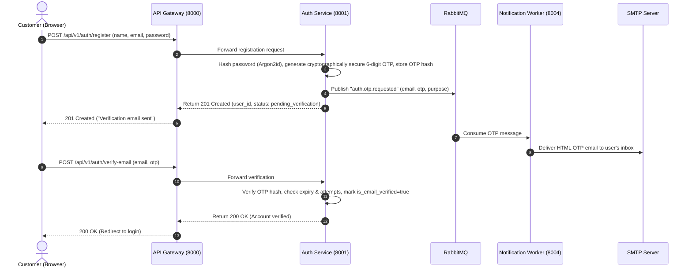
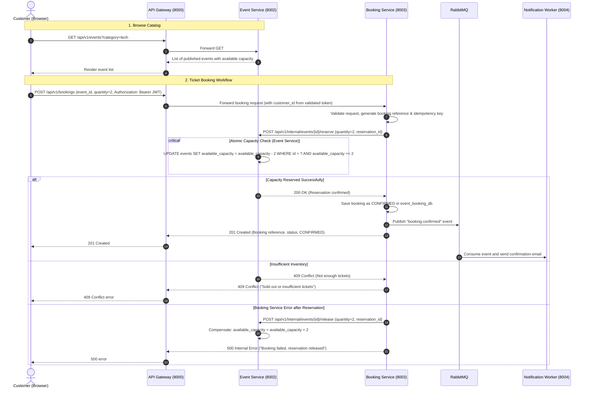

# Event Booking System — Architecture Documentation

## 1. Monolith vs. Microservices

### What is a Monolithic Architecture?
In a monolithic application, all features (user registration, event browsing, ticket booking, payment processing, sending emails) live within a single codebase and run as a single process accessing one shared database.
- **Pros**: Easy to start, single repository, simpler transactions (ACID in one database), single deployment unit.
- **Cons**: As the application grows, components become tightly coupled; if the email sending code crashes or consumes all CPU, event browsing goes down too; scaling means replicating the whole application rather than the bottleneck component.

### What is a Microservices Architecture?
In a microservices architecture, the application is divided into independent, loosely coupled services organized around business domains.
Each microservice:
1. **Owns its own data**: No service can directly query or write to another service's database.
2. **Runs as an independent process**: Deployed, restarted, or scaled without touching other services.
3. **Communicates via well-defined contracts**: Synchronous HTTP/REST for immediate data queries and reservations, and asynchronous message broker (RabbitMQ) for event-driven notifications.

---

## 2. System Overview & Services

| Service | Port | Database | Primary Responsibility |
|---|---|---|---|
| **API Gateway** | `8000` | None | Single entrypoint for frontend, routes requests, CORS, rate limiting, request IDs |
| **Auth Service** | `8001` | `event_auth_db` | User accounts, password hashing (Argon2id), email OTPs, JWT access & refresh tokens |
| **Event Service** | `8002` | `event_catalog_db` | Event catalog, categories, search/filter, atomic inventory reservations and releases |
| **Booking Service** | `8003` | `event_booking_db` | Booking lifecycle, reference codes, state transitions, coordinating reservation with Event Service |
| **Notification Service** | `8004` | `event_notification_db` | Consumes RabbitMQ queue, renders HTML templates, sends emails via SMTP with retries |

---

## 3. Communication Patterns

### A. Synchronous (HTTP / REST)
Used when a service needs an immediate response to decide its next step:
- The React frontend talks only to the **API Gateway** (`http://localhost:8000`).
- The **API Gateway** proxies requests to the internal services (`8001`, `8002`, `8003`).
- When a customer creates a booking, the **Booking Service** calls the **Event Service** via HTTP:
  `POST /api/v1/internal/events/{id}/reserve`
  If the Event Service confirms tickets are reserved, the Booking Service confirms the booking.

### B. Asynchronous (RabbitMQ Message Broker)
Used when the caller does not need to block waiting for completion:
- When a user registers or a booking is confirmed, the service publishes an event to RabbitMQ (e.g., `user.registered` or `booking.confirmed`).
- The **Notification Service** worker pulls this message off the queue in the background and sends the email via SMTP.
- If the email server is slow or temporarily down, the user's HTTP request is not delayed, and RabbitMQ will safely retry delivery.

---

## 4. End-to-End Request Flows

### Flow 1: Registration & OTP Verification

---

### Flow 2: Event Browsing and Ticket Booking

---

## 5. Security & Boundary Rules
1. **Never cross-query databases**: Auth cannot join tables with Booking; Booking cannot join tables with Event. Identifiers (`customer_id`, `event_id`) are foreign keys logically, verified over API.
2. **Never store plain text secrets**: Passwords hashed with Argon2id; OTPs and Refresh Tokens stored as cryptographic hashes (`SHA-256`).
3. **Role enforcement**: Frontends provide route guards for smooth UX, but every backend service independently validates JWT signatures and permissions on incoming requests.
